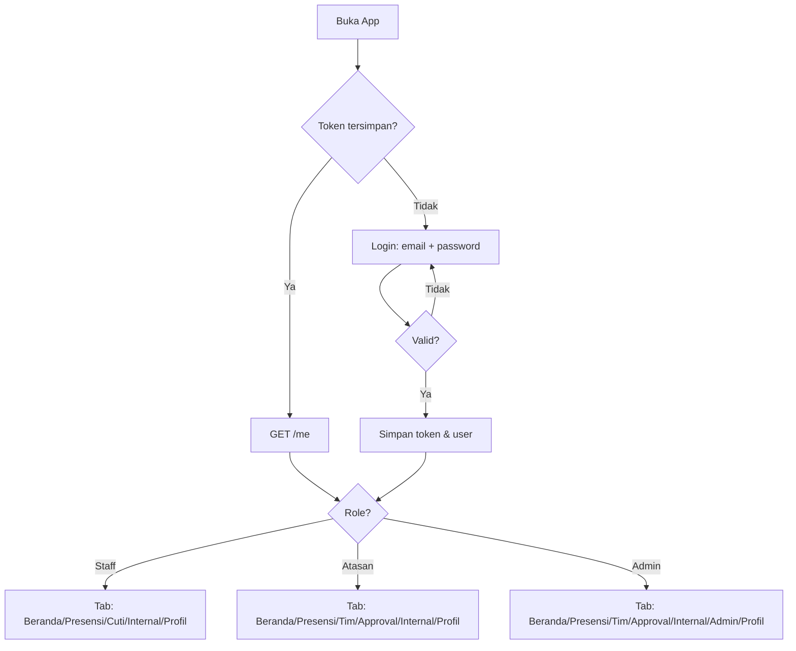
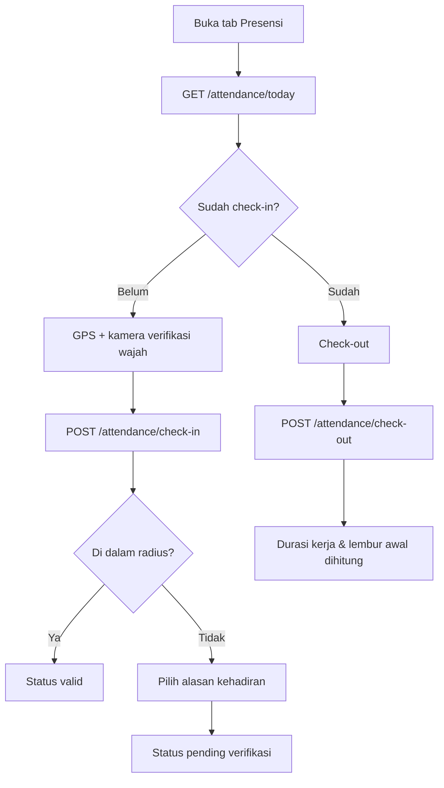
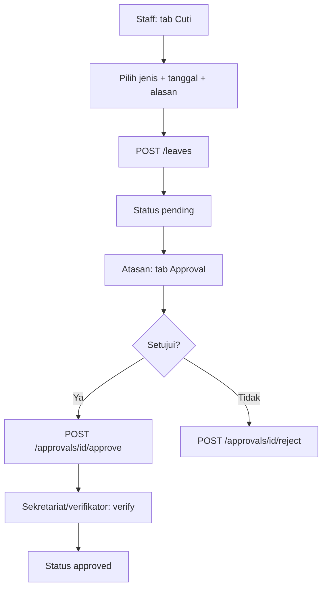
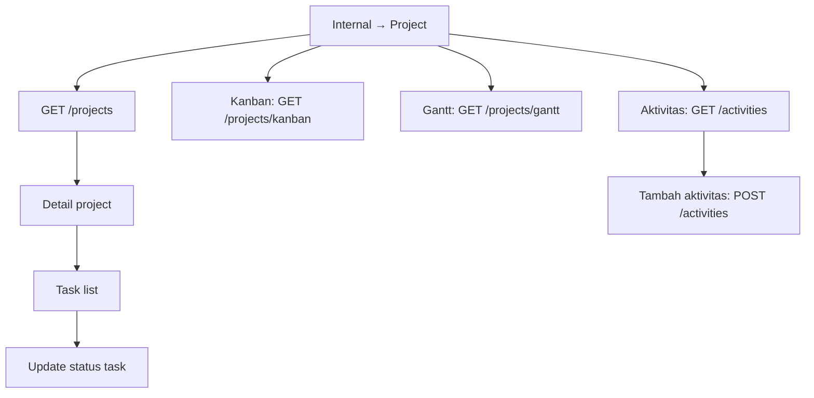

# RST Internal Mobile App (React Native / Expo)

Aplikasi mobile pendamping **RstInternalApp** (Laravel). Layout mengikuti versi web
(warna biru, kartu, badge status) tetapi navigasi utama memakai **bottom tabs**
yang dikondisikan berdasarkan role pengguna.

## 1. Prasyarat

- Node.js 18+ dan npm
- Expo CLI (`npx expo`)
- Server Laravel `RstInternalApp` berjalan dan bisa diakses dari perangkat
- Akun user terdaftar (password normal atau spy password internal)

## 2. Setup

```bash
cd mobile_app
cp .env.example .env
# Edit .env → EXPO_PUBLIC_API_URL
npm install
npx expo start
```

Contoh `.env` produksi:

```
EXPO_PUBLIC_API_URL=https://hr.rajasakti.co.id/api/mobile
```

Catatan:
- Build `preview` dan `production` di `eas.json` sudah memakai domain `https://hr.rajasakti.co.id/api/mobile`.
- Untuk development lokal, timpa `EXPO_PUBLIC_API_URL` di `.env` dengan IP LAN server, mis. `http://192.168.1.10/api/mobile`.
- Android emulator lokal: `http://10.0.2.2/api/mobile`.
- Backend sudah menyediakan API token (`/api/mobile/login`) sehingga tidak perlu cookie/session.

## 3. Navigasi per Role

| Role | Bottom Tabs |
| --- | --- |
| **Staff / Karyawan** | Beranda, Presensi, Cuti, Internal, Profil |
| **Atasan** (GM/Sekretaris/Manager/Supervisor) | Beranda, Presensi, Tim, Approval, Internal, Profil |
| **Admin / Direksi** | Beranda, Presensi, Tim, Approval, Internal, Admin, Profil |

Tab **Admin** membuka shortcut ke halaman web (master data, laporan, pengaturan,
server & domain, manage data, email log) agar fitur administrasi tetap lengkap.

## 4. Alur Proses (sama dengan web)

### 4.1 Login & Routing Role



### 4.2 Presensi (Check-in / Check-out)



### 4.3 Pengajuan Cuti & Approval



### 4.4 Project, Kanban, Gantt, Aktivitas



### 4.5 Konten

- `GET /contents/videos` → video tutorial
- `GET /contents/dokumentasi` → dokumentasi/panduan
- `GET /contents/pengumuman` → pengumuman

## 5. Struktur Folder

```
mobile_app/
├─ App.tsx
├─ app.json
├─ src/
│  ├─ api/            # axios client + endpoint functions
│  ├─ components/     # Screen, Card, Button, Field, Badge
│  ├─ context/        # AuthContext (token & user)
│  ├─ navigation/     # RootNavigator, BottomTabs, InternalNavigator
│  ├─ screens/        # Login, Dashboard, Presensi, Cuti, Tim, Approval, Internal, Admin, Profil
│  ├─ theme/          # warna, spacing, shadow, status color
│  └─ types.ts
└─ README.md
```

## 6. Backend API (Laravel)

Semua endpoint di bawah prefix `/api/mobile`:

| Method | Endpoint | Keterangan |
| --- | --- | --- |
| POST | `/login` | Login, mengembalikan token |
| GET | `/me` | Profil user login |
| POST | `/logout` | Hapus token |
| GET | `/dashboard` | Ringkasan role & statistik |
| GET | `/attendance/today` | Presensi hari ini + kantor + alasan |
| GET | `/attendance/face-capture-url` | URL signed (10 menit) untuk kamera verifikasi wajah |
| POST | `/attendance/check-in` | Check-in (lat, lng, foto, skor wajah, alasan) |
| POST | `/attendance/check-out` | Check-out |
| GET | `/attendance/history` | Riwayat presensi |
| GET | `/leaves` | Pengajuan cuti user |
| POST | `/leaves` | Ajukan cuti |
| GET | `/leaves/types` | Jenis cuti aktif |
| GET | `/approvals` | Pengajuan pending tim |
| POST | `/approvals/{id}/approve` | Setujui |
| POST | `/approvals/{id}/reject` | Tolak |
| GET | `/team` | Anggota tim + presensi hari ini |
| GET | `/projects` | Daftar project |
| GET | `/projects/{id}` | Detail project + task + member |
| GET | `/projects/kanban` | Board per status |
| GET | `/projects/gantt` | Task timeline |
| POST | `/projects/tasks/{id}` | Update status/progress task |
| GET | `/activities` | Log aktivitas |
| POST | `/activities` | Input aktivitas |
| GET | `/contents/videos` | Video tutorial |
| GET | `/contents/dokumentasi` | Dokumentasi |
| GET | `/contents/pengumuman` | Pengumuman |
| GET | `/profile` | Profil |
| PUT | `/profile` | Ubah nama/telepon |

Token disimpan di `api_tokens` (hash SHA-256, berlaku 30 hari).

## 7. Catatan

- Face recognition mobile memakai **engine yang sama dengan web** (face-api.js).
  Aplikasi membuka halaman `/mobile/face-capture/{user}` lewat WebView dengan signed
  URL berumur 10 menit, mendeteksi wajah otomatis, lalu mengirim `photo_data` +
  `face_score` ke API. Threshold dan avatar sama persis dengan versi web.
- `react-native-webview` sudah tersedia di Expo Go; build ulang APK untuk produksi.
- Menu administrasi di mobile membuka versi web agar CRUD/master data tetap lengkap.
- Bottom tab otomatis menyesuaikan role dari response `/me`.
